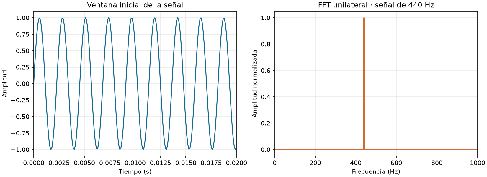
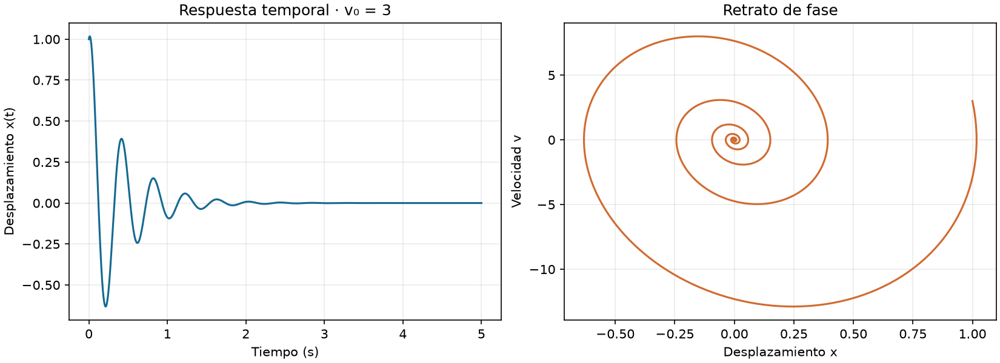
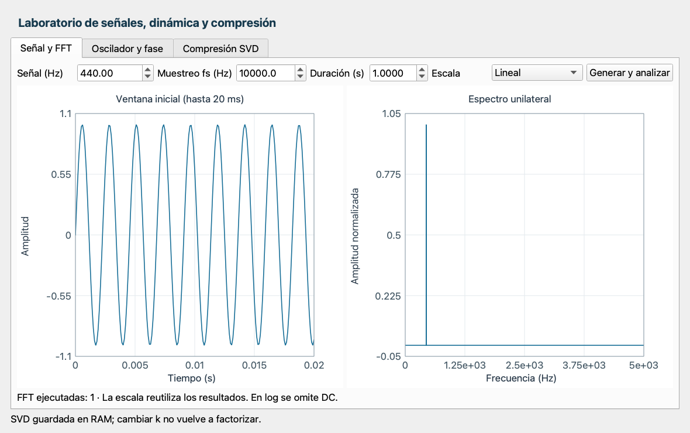
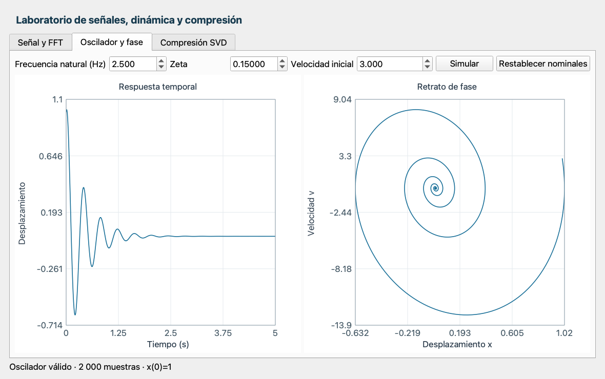
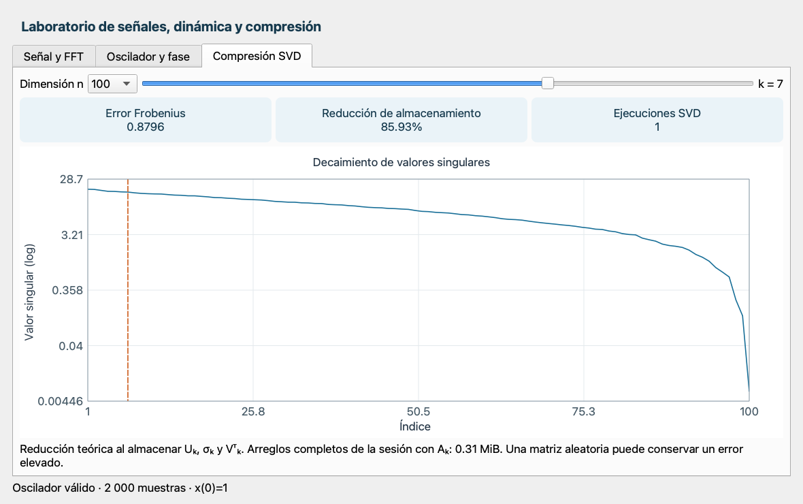

# Reporte de Tarea 4

## Objetivo y alcance

Se desarrollaron herramientas para análisis espectral, dinámica de un oscilador y aproximación matricial, separando el cálculo de la interfaz y reutilizando resultados costosos. Se usaron los cinco cuadernos `Semana 3 - Ejemplos_A` a `Ejemplos_E` como referencia y el planteamiento proporcionado como especificación. El ejemplo D contiene una adaptación con ipywidgets; aquí se construyó la versión Tkinter solicitada. No se proporcionó una clase MATLAB `JerarquiaPOO.m`, por lo que se creó su implementación.

Python presenta FFT y oscilador en Tkinter, y SVD en Streamlit. MATLAB y C++ reúnen las tres actividades en aplicaciones con pestañas. C++ utiliza Qt para la vista y Eigen para cálculo. Esta tarea estudia arquitectura, estado y validación; las tablas de tiempos de las tareas anteriores no forman parte de este planteamiento.

## 1. Separación Modelo–Vista–Controlador

| Responsabilidad | Python | MATLAB | C++ |
|---|---|---|---|
| Modelo: cálculo sin componentes gráficos | `modelo.py` | Funciones `.m` y método privado `calcularEspectroFFT` | `models.hpp` |
| Vista: controles, lienzos y métricas | `vista_tk.py`, `vista_streamlit.py` | Creación de componentes y métodos de dibujo en `JerarquiaPOO` | `view.hpp` |
| Controlador: eventos, validaciones y actualización del estado | `controlador_tk.py`, `app_streamlit.py`, `estado.py` | Callbacks de `JerarquiaPOO` | `controller.hpp` |
| Estado persistente | Objetos de estado y `st.session_state` | Propiedades privadas | Estructuras de estado del controlador |

La tabla muestra dónde se encuentra cada responsabilidad. En MATLAB las responsabilidades de vista y controlador están organizadas en métodos de una misma clase, mientras que las funciones numéricas independientes permiten probar el cálculo sin abrir la aplicación. El método privado solicitado lee la señal y devuelve el espectro sin dibujar.

El controlador valida antes de confirmar un resultado nuevo. Una entrada inválida conserva el último resultado válido. En Tkinter y C++ el cálculo pesado de FFT se realiza en un trabajador y la actualización gráfica ocurre en el hilo principal; C++ también calcula SVD en segundo plano. MATLAB muestra progreso modal durante el cálculo síncrono: no se presenta como una implementación de cálculo en segundo plano.

## 2. Señal y FFT unilateral

Se construye una señal de amplitud unitaria:

$$
y_j=\sin\left(2\pi f\frac{j}{f_s}\right),
\qquad j=0,\ldots,N-1.
$$

El controlador exige valores finitos, frecuencia y duración positivas y **$f_s>2f$**. El valor inicial es $f_s=10000$ Hz. Se limita la señal a un máximo de un millón de muestras para evitar asignaciones desproporcionadas.

Después se calcula $Y=\mathrm{FFT}(y)$. Para el espectro unilateral:

$$
f_k=\frac{kf_s}{N},
\qquad
P_k=\frac{|Y_k|}{N},
\qquad
0\leq k\leq\left\lfloor\frac{N}{2}\right\rfloor.
$$

Se duplican las amplitudes positivas, excepto el término de Nyquist cuando $N$ es par; DC nunca se duplica. Así se recupera la amplitud de una senoide cuyo número de ciclos coincide con la ventana de observación. Para frecuencias que no coinciden con un bin puede aparecer fuga espectral: no se aplica ventana adicional.

En MATLAB, `VectorFrecuencias` y `MagnitudEspectro` son propiedades privadas. Cambiar entre escala lineal y semilogarítmica solamente dibuja esos arreglos. En escala logarítmica se omite la frecuencia cero porque su logaritmo no está definido. La ventana temporal inicial de hasta 20 ms facilita ver los ciclos; el análisis utiliza la señal completa.



## 3. Oscilador con velocidad inicial

El modelo implementado es el oscilador lineal libre amortiguado:

$$
x''+2\zeta\omega_n x'+\omega_n^2x=0.
$$

Donde la frecuencia angular natural y las condiciones iniciales están dadas por:

$$
\omega_n=2\pi f,
\qquad
x(0)=x_0=1,
\qquad
x'(0)=v_0.
$$

Aunque el texto introductorio menciona sistemas no lineales, la ecuación del ejemplo corresponde a un sistema lineal. Se restringe a $0<f\leq50$ Hz y $0\leq\zeta<1$, tal como se solicita.

Definiendo el coeficiente de amortiguamiento y la frecuencia angular amortiguada:

$$
a=\zeta\omega_n,
\qquad
\omega_d=\omega_n\sqrt{1-\zeta^2}.
$$

La solución para el desplazamiento es:

$$
x(t)=e^{-at}
\left[
x_0\cos(\omega_dt)
+
(v_0+ax_0)
\frac{\sin(\omega_dt)}{\omega_d}
\right].
$$

La solución para la velocidad es:

$$
v(t)=e^{-at}
\left[
v_0\cos(\omega_dt)
-
(\omega_n^2x_0+av_0)
\frac{\sin(\omega_dt)}{\omega_d}
\right].
$$

Se usa una evaluación estable del cociente seno/frecuencia cerca del amortiguamiento crítico. Al sustituir $t=0$, se obtiene exactamente $x(0)=x_0$ y $v(0)=v_0$. La función devuelve tres arreglos: tiempo, desplazamiento y velocidad. No estima la velocidad mediante diferencias finitas.

Tkinter vincula la velocidad inicial con una `DoubleVar` y un `ttk.Entry`. El botón de restablecimiento modifica las variables con `.set()` y vuelve a dibujar. Los subgráficos `121` y `122` muestran desplazamiento contra tiempo y velocidad contra desplazamiento. Los valores fuera del dominio producen `messagebox.showwarning`.

Con amortiguamiento positivo la trayectoria de fase converge al origen; sin amortiguamiento conserva su energía y forma una curva cerrada.



## 4. SVD, caché y compresión

El modelo genera una matriz gaussiana cuadrada con un generador local de semilla fija. Para la misma dimensión, cada implementación es reproducible sin modificar el estado aleatorio global. Los generadores de los tres lenguajes no producen necesariamente la misma matriz.

Se factoriza una sola vez por cambio de dimensión:

$$
A=U\Sigma V^T.
$$

En Python se utiliza `np.linalg.svd(A, full_matrices=False)`. El controlador conserva los factores en `st.session_state` y muestra `st.spinner` durante la factorización.

Para un rango de reconstrucción dentro del intervalo:

$$
1\leq k\leq\left\lfloor\frac{n}{10}\right\rfloor,
$$

se reconstruye la matriz mediante:

$$
A_k=
U_{:,:k}
\mathrm{diag}(\sigma_{:k})
V^T_{:k,:}.
$$

De manera equivalente, la aproximación de rango $k$ puede expresarse como:

$$
A_k=\sum_{i=1}^{k}\sigma_i u_i v_i^T.
$$

Mover el deslizador cambia la reconstrucción, su error y la gráfica, pero no vuelve a ejecutar SVD. El estado guarda la dimensión actual; no acumula matrices de todas las dimensiones visitadas. Las opciones de interfaz son 100, 250, 500 y 1000.

Las tres métricas utilizadas son las siguientes.

### Error relativo de reconstrucción

$$
E=\frac{\left\|A-A_k\right\|_F}
{\left\|A\right\|_F}.
$$

Donde $\|\cdot\|_F$ representa la norma de Frobenius.

### Porcentaje de reducción de almacenamiento

$$
R=100\left(1-\frac{2nk+k}{n^2}\right).
$$

### Contador de factorizaciones

$$
C=\text{número de factorizaciones completadas}.
$$

**La reducción $R$ corresponde al almacenamiento de los factores truncados**, no a una medición de RAM liberada por la aplicación.

Una matriz original requiere:

$$
N_{\text{original}}=n^2.
$$

Mientras que los factores truncados requieren:

$$
N_{\text{truncado}}=nk+k+kn=2nk+k.
$$

Para poder interactuar se mantienen la matriz y los factores completos en RAM. Contando además una reconstrucción completa y datos `float64`, sus arreglos suman aproximadamente:

$$
M=8(4n^2+n)\quad\text{bytes}.
$$

Este cálculo no incluye temporales, objetos ni espacio de trabajo de las bibliotecas. No representa la memoria total del proceso.

La gráfica utiliza escala logarítmica vertical para los valores singulares y una línea discontinua en el índice $k$. Una matriz gaussiana densa suele tener rango completo: reducir mucho el almacenamiento puede dejar un error grande. Eso es un resultado esperado, no un fallo del algoritmo.


## 5. Resultados y explicación de las tablas

### Resultados numéricos representativos

| Experimento | Resultado observado | Interpretación |
|---|---:|---|
| FFT: seno de 440 Hz, fs=10000 Hz, duración 1 s | Pico a 440 Hz | Ubicación correcta de la frecuencia de entrada |
| Amplitud del pico | 0.9999999999999998 | Coincide con amplitud 1 dentro del error de punto flotante |
| SVD Python: n=100, k=7 | Error relativo 0.876584 | Se conserva solamente una parte de la matriz aleatoria |
| Almacenamiento truncado: n=100, k=7 | Reducción 85.93 % | 1407 números frente a 10000 de la matriz original |
| Arreglos completos de esa sesión, incluyendo Ak | 320800 bytes | Aproximadamente 0.306 MiB; no representa el ahorro ni la memoria total del proceso |

La tabla reúne mediciones del archivo `evidencias/resultados_numericos.json`. La coincidencia del pico valida la FFT. La combinación de ahorro alto y error alto muestra el compromiso de comprimir una matriz sin estructura marcada. Los resultados de error SVD de C++ pueden diferir porque su matriz aleatoria es distinta; la fórmula de almacenamiento sí coincide.

Para el caso de una matriz de dimensión $n=100$ y rango de reconstrucción $k=7$, el número de elementos originales es:

$$
N_{\text{original}}=100^2=10000.
$$

El número de elementos almacenados mediante los factores truncados es:

$$
N_{\text{truncado}}=2(100)(7)+7=1407.
$$

Por lo tanto, el porcentaje de reducción de almacenamiento es:

$$
R=100\left(1-\frac{1407}{10000}\right)
=85.93\%.
$$

La memoria correspondiente a los arreglos completos de la sesión es:

$$
M=8\left(4(100)^2+100\right)
=320800\quad\text{bytes}.
$$

### Auditoría de la caché en Streamlit

| Ejecución de la aplicación | Dimensión n | Rango k | Contador de SVD |
|---:|---:|---:|---:|
| 1: inicial | 100 | 1 | 1 |
| 2: cambio de rango | 100 | 7 | 1 |
| 3: cambio de dimensión | 250 | 1 | 2 |
| 4: cambio de rango | 250 | 25 | 2 |
| 5: regreso a dimensión anterior | 100 | 1 | 3 |

Esta tabla reproduce los cinco ciclos comprobados con `AppTest`. Las filas 2 y 4 demuestran reutilización de los mismos factores al mover $k$. La fila 5 demuestra que se conserva solamente la dimensión actual; volver a una dimensión anterior calcula una nueva factorización.

### Verificación ejecutada y límites

| Componente | Verificación | Resultado |
|---|---|---|
| Modelos y estado Python | 9 pruebas: FFT, dominios, condiciones iniciales, energía, SVD, aleatoriedad y caché | Correcto |
| Controlador Tkinter | Variables Tcl reales, vista simulada, reinicio y advertencias | Correcto; ventana nativa pendiente |
| Streamlit | 5 ejecuciones reales del script mediante AppTest | Correcto; no es una prueba visual en navegador |
| C++ numérico | FFT, oscilador, SVD y entradas inválidas | Correcto |
| C++ interfaz Qt | Eventos, cachés, advertencias, reinicio y capturas sin pantalla | Correcto |
| Funciones MATLAB en GNU Octave 10.3 | Modelos, dominios, RNG y exportación de datos | Correcto |
| Comparación Python–MATLAB/Octave | Arreglos del oscilador y FFT con entradas comunes, dentro de tolerancia | Correcto |
| Interfaz MATLAB | Requiere MATLAB y sus componentes gráficos | No ejecutada: MATLAB no está instalado |

La tabla separa la validación matemática de la interfaz. Probar funciones `.m` en Octave no certifica la ejecución de App Designer. Los registros originales se encuentran en `evidencias/pruebas_*.log`; `verificacion.json` conserva los códigos de salida. No se han inventado resultados de ventanas que no pudieron abrirse.

### Capturas de la aplicación C++

Estas imágenes se obtuvieron renderizando los componentes reales de Qt con el backend `offscreen`:

#### Interfaz de análisis espectral FFT



#### Interfaz del oscilador amortiguado



#### Interfaz de aproximación matricial SVD



## 6. Reproducción y cierre

Las instrucciones completas están en [README.md](README.md).

Para compilar cuando sea necesario, ejecutar las verificaciones y generar las evidencias:

```bash
python3 ejecutar.py pruebas
```

Para regenerar las gráficas usando los datos exportados:

```bash
python3 ejecutar.py evidencias
```

La optimización central consiste en conservar la FFT cuando solo cambia su escala y conservar la SVD cuando solo cambia el rango. Las validaciones evitan actualizar el estado con datos inválidos, y los modelos separados permiten comprobar fórmulas sin depender de una ventana gráfica.

Queda por verificar manualmente la ventana Tkinter en una sesión gráfica y la interfaz MATLAB en una instalación de MATLAB.

## Referencias técnicas

- [MathWorks: FFT y espectro unilateral](https://www.mathworks.com/help/matlab/ref/fft.html).
- [Streamlit: AppTest para pruebas de aplicaciones](https://docs.streamlit.io/develop/api-reference/app-testing/st.testing.v1.apptest).
- Material base: cinco cuadernos Semana 3 proporcionados por el usuario y planteamiento de Tarea 4.

## Justificación del uso de Inteligencia Artificial

El desarrollo del presente proyecto incorporó herramientas de inteligencia artificial generativa como apoyo técnico y metodológico para proponer código, organizar las interfaces y preparar procedimientos de compilación, depuración y verificación en Python, MATLAB y C++. Su utilización tuvo como finalidad agilizar el desarrollo y facilitar la adaptación de los ejemplos a los requerimientos de la actividad. La responsabilidad de revisar, comprender y aceptar el código permanece en quien presenta el proyecto.

Las propuestas se contrastaron con las ecuaciones, las restricciones físicas y los resultados de las pruebas disponibles. Esta revisión permitió comprobar las condiciones iniciales del oscilador, la normalización de la FFT, la reconstrucción mediante SVD y la reutilización de los resultados almacenados. No se midió el tiempo de desarrollo con y sin IA, por lo que no se atribuye una reducción cuantitativa de tiempos a su uso.

### Fragmentos de interfaz asistidos por IA generativa

| Entorno y archivos | Asistencia utilizada |
|---|---|
| Tkinter: `python/vista_tk.py` y `python/controlador_tk.py` | Organización de pestañas y controles mediante `grid`, vinculación con `DoubleVar`, integración de `FigureCanvasTkAgg`, gráficas temporal y de fase, advertencias y callback de restablecimiento. También se asistió la coordinación del trabajador de FFT con el hilo gráfico. |
| Streamlit: `python/vista_streamlit.py` y `python/app_streamlit.py` | Selector de dimensión, deslizador de rango, tres métricas, gráfica semilogarítmica, indicador de espera y coordinación del estado de sesión para no repetir la SVD al cambiar k. |
| MATLAB: `matlab/JerarquiaPOO.m` | Construcción programática de `uifigure`, `uigridlayout`, pestañas, `uiaxes`, campos numéricos, alertas y diálogos de progreso; propiedades privadas para conservar resultados y callbacks para redibujarlos. |
| C++/Qt: `cpp/view.hpp`, `cpp/controller.hpp` y `cpp/main.cpp` | Distribución de controles y pestañas, renderizado de curvas, tarjetas de métricas, mensajes de advertencia, reinicio y coordinación de cálculos en segundo plano con la actualización de la interfaz. |

La asistencia no se limitó a cambios estéticos: también intervino en propuestas de modelos numéricos, manejo del estado, pruebas y documentación. Las capturas incluidas corresponden a componentes reales de C++/Qt renderizados en modo sin pantalla; no acreditan por sí mismas una prueba manual de todas las interfaces.

### Revisión de la separación entre Vista y Modelo

La inspección del código comprobó que `python/modelo.py` no importa Tkinter ni Streamlit, y que `cpp/models.hpp` no depende de Qt. Las funciones numéricas independientes de MATLAB no requieren componentes gráficos. El método privado `calcularEspectroFFT(app)` lee la señal y devuelve los resultados sin realizar llamadas gráficas.

En sentido inverso, las vistas reciben datos para representarlos: no ejecutan la FFT ni la factorización SVD. El controlador coordina los eventos, solicita cálculos y actualiza la vista. Cambiar la escala reutiliza el espectro almacenado; cambiar k reutiliza los factores de la dimensión actual. Estas transiciones se comprobaron mediante pruebas de estado, AppTest y eventos de la interfaz Qt.

La separación es funcional, no una ausencia absoluta de dependencias: la vista conoce la estructura de los datos que representa. Además, `JerarquiaPOO.m` reúne responsabilidades de vista y controlador y contiene el método numérico privado exigido por el planteamiento. Por tanto, se verificó la independencia del cálculo respecto de los componentes gráficos, sin afirmar un desacoplamiento total entre todos los objetos de la aplicación.

### Revisión de memoria y alcance de la verificación

La inspección identificó los siguientes mecanismos de gestión de recursos:

- Las cachés conservan el resultado de la configuración actual y reemplazan el anterior; no mantienen un historial de matrices por cada movimiento de los controles.
- Tkinter reutiliza los lienzos y sus ejes. Al cerrar, solicita la cancelación de trabajos pendientes y destruye la ventana; un trabajo que ya esté ejecutándose puede terminar después de esa solicitud.
- Streamlit crea figuras mediante `matplotlib.figure.Figure`, sin registrarlas mediante `pyplot.figure`. Su liberación efectiva depende de las referencias existentes y del recolector de memoria; este diseño no demuestra por sí solo ausencia de fugas.
- Qt utiliza la jerarquía de propiedad de los widgets incorporados a contenedores y layouts. Los arreglos y factores emplean contenedores con gestión automática de recursos. Los vectores de dibujo se reemplazan y pueden conservar capacidad reservada para reutilizarla.
- MATLAB define la destrucción de la ventana y el cierre de los diálogos de progreso. Esta lógica se revisó en el código, pero no se ejecutó la interfaz en MATLAB.

La IA se utilizó como apoyo para construir y comprobar la solución; la conclusión técnica se limita a las evidencias disponibles. La independencia del cálculo y el comportamiento de la caché cuentan con revisión de código y pruebas.
