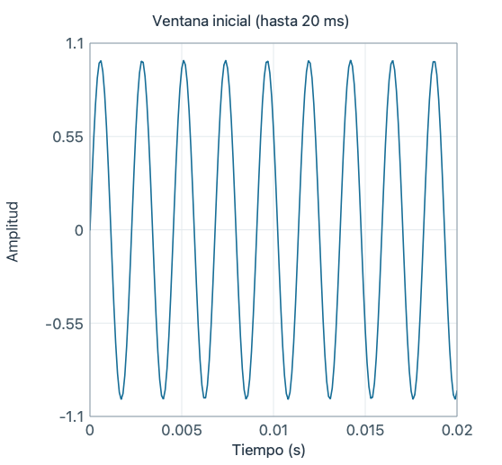
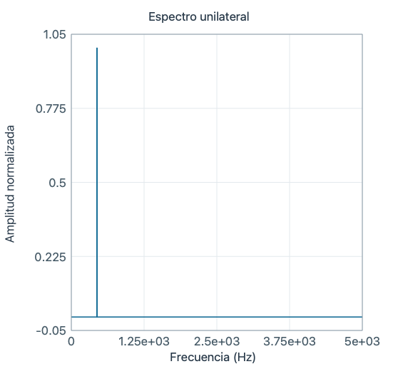
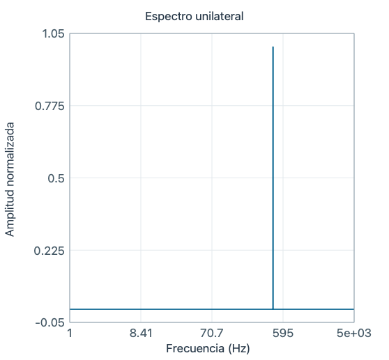
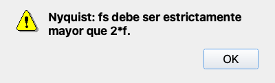
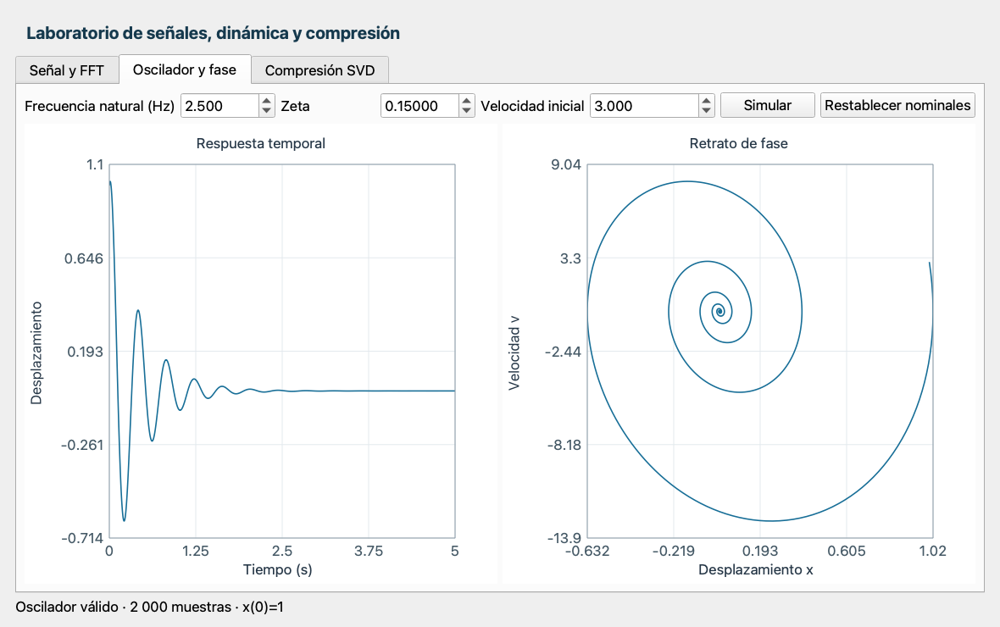
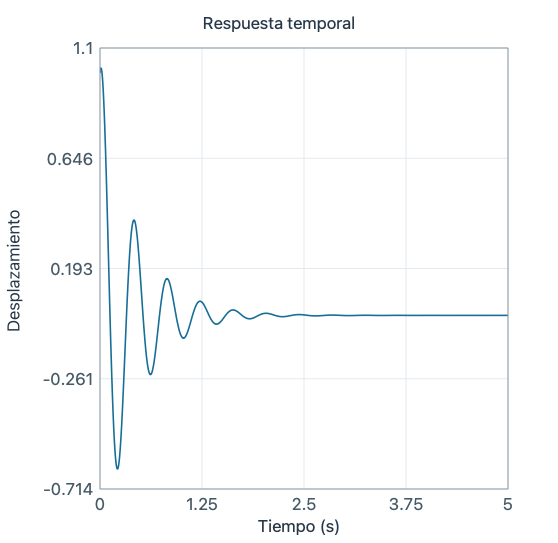
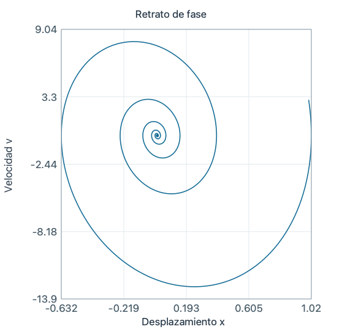
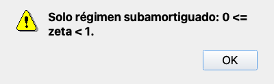
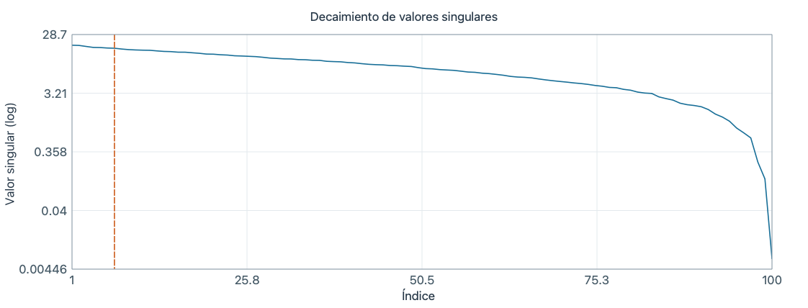
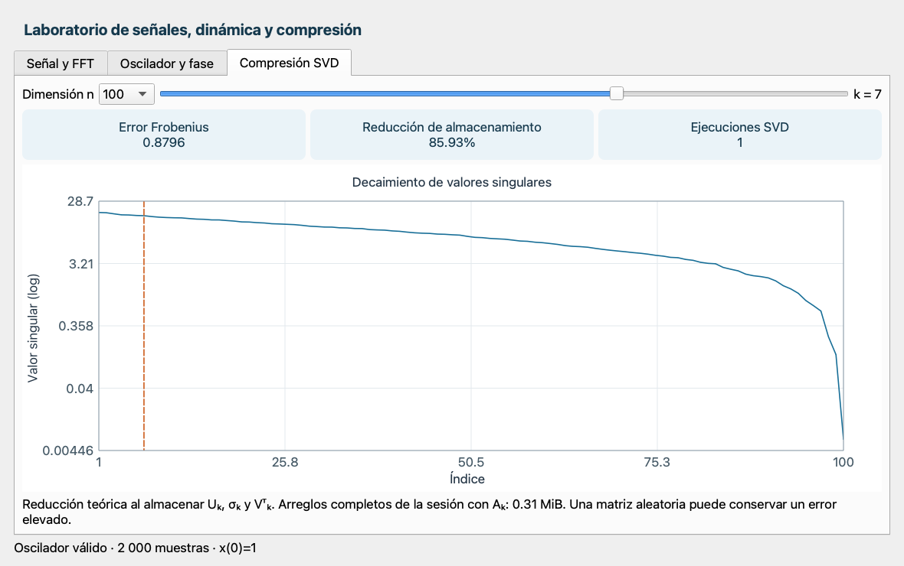

# Figuras del análisis de señales

Capturas reales de la aplicación C++/Qt renderizadas sin pantalla; no son capturas de MATLAB. Señal de 440 Hz, muestreo válido de 10000 Hz y duración de 1 s. La vista temporal muestra los primeros 20 ms. La escala logarítmica corresponde al eje de frecuencias.

*Figura 1. Representación temporal de la señal sinusoidal.*

*Figura 2. Espectro de amplitud de la señal utilizando escala lineal.*

*Figura 3. Espectro de amplitud de la señal utilizando escala logarítmica.*

*Figura 4. Advertencia mostrada al introducir una frecuencia de muestreo no válida.*

La advertencia se activó con fs = 880 Hz para una señal de 440 Hz: se exige fs > 2f. Cambiar la escala y provocar la advertencia mantuvo el contador en una sola FFT.

## Oscilador amortiguado — Figuras 5 a 9

Capturas reales de C++/Qt renderizadas sin pantalla. En las figuras 5 a 7 se utilizó f = 2.5 Hz, zeta = 0.15 y velocidad inicial = 3. La figura 8 corresponde a introducir zeta = 1. La figura 9 se capturó después de pulsar Restablecer nominales: f = 2.5 Hz, zeta = 0.15 y velocidad inicial = 0.

*Figura 5. Interfaz para modificar los parámetros del sistema oscilatorio.*

*Figura 6. Evolución temporal del desplazamiento del oscilador amortiguado.*

*Figura 7. Representación del plano de fase mediante la relación entre velocidad y desplazamiento.*

*Figura 8. Mensaje de advertencia ante la introducción de parámetros fuera del rango permitido.*

*Figura 9. Estado de la interfaz después de utilizar la función de reinicio.*

## Valores singulares — Figura 11

Captura de la aplicación C++/Qt: matriz de 100 × 100, rango seleccionado k = 7. El eje vertical utiliza escala logarítmica y la línea discontinua marca el corte después de las primeras siete componentes.

*Figura 11. Representación de los valores singulares en escala logarítmica y delimitación de las componentes seleccionadas.*

## Configuración de la matriz — Figura 10

Captura de C++/Qt con dimensión n = 100 y rango k = 7.

*Figura 10. Interfaz de la aplicación para configurar la dimensión de la matriz y el rango de aproximación.*

[Figuras 12 a 20 con sus pies y condiciones de ejecución](FIGURAS_12_20.md).
