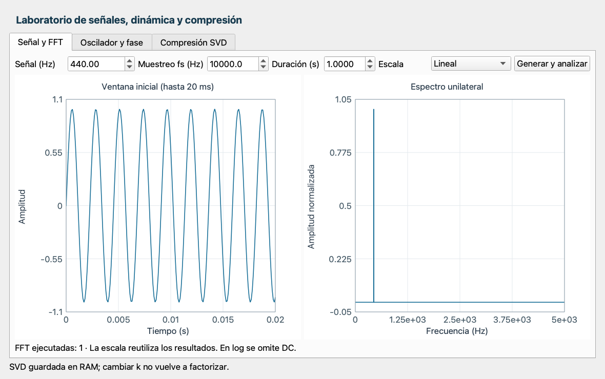
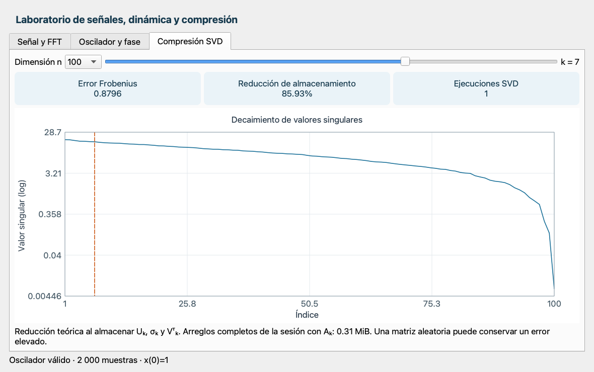
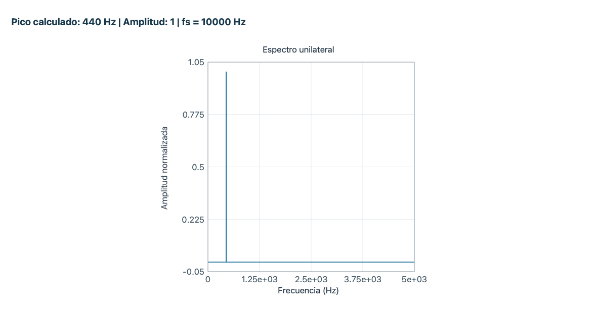
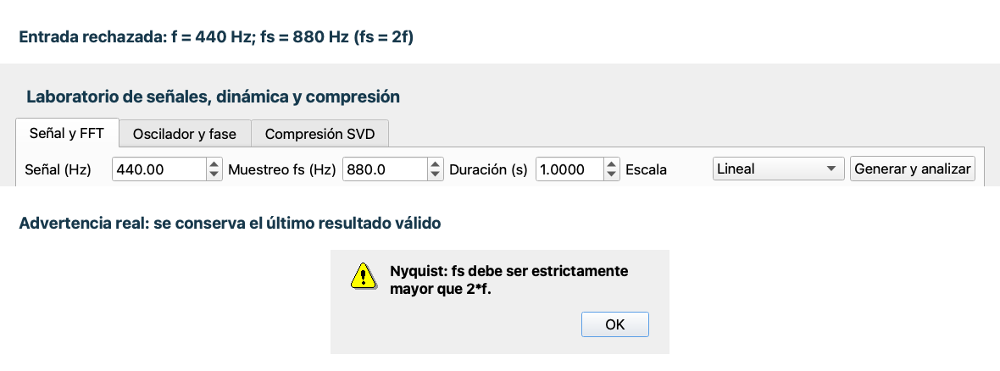
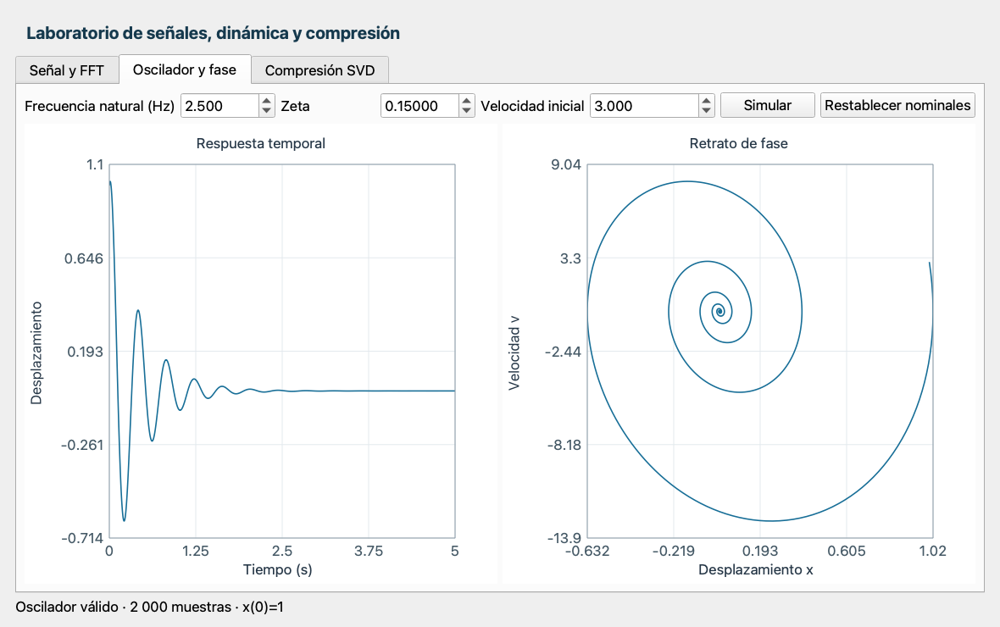
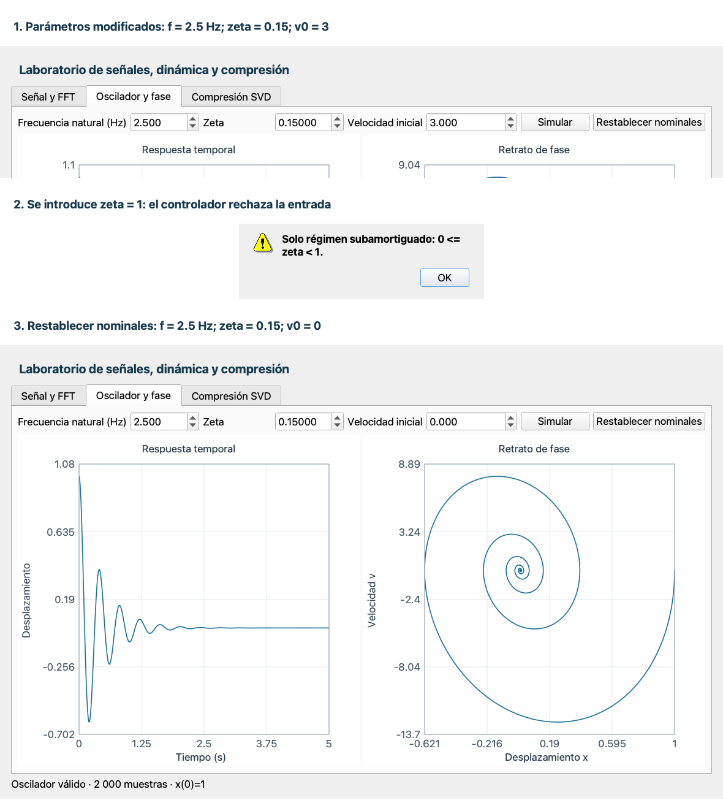
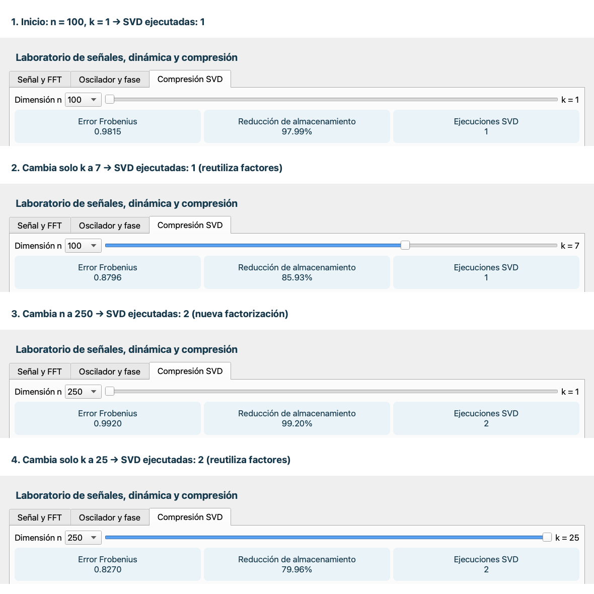

# Figuras 12 a 20 — Aplicación C++/Qt

Capturas de componentes reales renderizados con Qt en modo sin pantalla. Las figuras 16, 18 y 20 reúnen capturas de varios estados; sus rótulos explican la secuencia observada. No son capturas de MATLAB ni de Tkinter.

*Figura 12. Indicadores obtenidos para evaluar la aproximación de la matriz.*

*Figura 13. Interfaz principal de la aplicación desarrollada en C++ mediante Qt.*

*Figura 14. Ejemplo de ejecución de una de las actividades desde la interfaz desarrollada en C++.*

*Figura 15. Identificación de la frecuencia de 440 Hz en el espectro calculado.*

*Figura 16. Respuesta de la aplicación ante una frecuencia de muestreo que no cumple el criterio establecido.*

*Figura 17. Ejemplo de la respuesta temporal y el plano de fase del oscilador.*

*Figura 18. Comprobación de los controles de validación y restablecimiento de parámetros.*

*Figura 19. Métricas obtenidas durante la reconstrucción de una matriz de dimensión 100 × 100.*

*Figura 20. Verificación del comportamiento del mecanismo de caché al modificar la dimensión y el rango de aproximación.*

## Condiciones y verificación

- FFT: señal de 440 Hz, fs = 10000 Hz y duración de 1 s. El modelo identifica el máximo en 440 Hz con amplitud unitaria dentro de la tolerancia numérica.
- Muestreo inválido: fs = 880 Hz para f = 440 Hz; se rechaza porque se exige fs > 2f. El resultado previo permanece almacenado.
- Oscilador: f = 2.5 Hz, zeta = 0.15 y velocidad inicial 3. Zeta = 1 activa la advertencia. El botón de reinicio restaura f = 2.5 Hz, zeta = 0.15 y velocidad inicial 0.
- Figuras 12, 14 y 19: n = 100, k = 7, error relativo 0.8796, reducción teórica de almacenamiento 85.93 % y una ejecución de SVD. El ahorro corresponde a guardar factores truncados, no a medir la RAM liberada.
- Caché: (n, k, ejecuciones) = (100, 1, 1), (100, 7, 1), (250, 1, 2), (250, 25, 2). Se comprobó cada contador durante la ejecución.
